# Guía de Cesium en cessium-pruebas

Esta guía explica **cómo está construido el mapa**, paso a paso y en el orden en que se hace, con el código real del proyecto. Está pensada para entender qué hace cada cosa y para poder volver y encontrar rápido cómo se hacía algo.

> El README general del proyecto (cómo arrancar, estructura, glosario) está en [README.md](README.md). Aquí solo está la lógica del mapa.

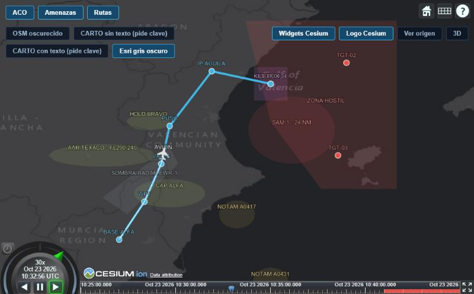

## Índice

1. [Cómo piensa Cesium](#1-cómo-piensa-cesium)
2. [Quiero cambiar... → voy a...](#2-quiero-cambiar--voy-a)
3. [Paso a paso: construir el mapa](#3-paso-a-paso-construir-el-mapa)
4. [Los botones propios y los de prueba](#4-los-botones-propios-y-los-de-prueba)
5. [Meter el mapa dentro de una web](#5-meter-el-mapa-dentro-de-una-web)
6. [Trucos y errores típicos](#6-trucos-y-errores-típicos)
7. [Créditos y licencias](#7-créditos-y-licencias)

---

## 1. Cómo piensa Cesium

Cesium dibuja un **globo terráqueo** (o un mapa plano) con WebGL. Para usarlo hay que conocer solo cinco ideas:

| Concepto | Qué es | Ejemplo en este proyecto |
|---|---|---|
| **Viewer** | El mapa completo: la ventana donde se ve todo | `crearMapa` |
| **Capa de imágenes** (*imagery layer*) | El mapa de fondo: miles de cuadraditos de imagen que se piden a un servidor | Esri gris oscuro (`crearCapaFondo`) |
| **Entidad** (*entity*) | Cualquier cosa que dibujas encima: un punto, una línea, una zona, un icono, un texto | Una elipse, la ruta, el avión |
| **DataSource** | Una caja donde metes entidades. Sirve para encender o apagar un grupo a la vez | `capaAco`, `capaAmenazas`, `capaRutas` |
| **Reloj** (*clock*) | La hora del mapa. Si una entidad depende del tiempo (el avión), se mueve cuando el reloj avanza | `visor.clock` |

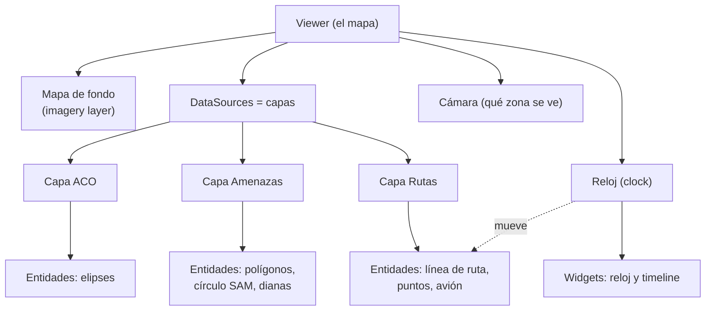

### Una regla de oro: las coordenadas

Las posiciones **no son píxeles**, son **longitud y latitud en grados**. Por eso el mapa se puede redimensionar o hacer zoom y todo sigue en su sitio.

> ⚠️ **Primero la longitud, después la latitud.** En Cesium es `(longitud, latitud)`, al revés de lo que se suele decir en voz alta ("latitud, longitud"). Es el fallo más típico.

Lo que sí mide píxeles (y no cambia con el zoom): el tamaño de los puntos, el icono del avión y el texto.

### Quién es de quién

| Parte | ¿De quién es? |
|---|---|
| Mapa de fondo, zoom, arrastrar, 2D/3D | **Cesium** |
| Reloj y barra de tiempo de abajo, barra de iconos de arriba a la derecha, créditos | **Cesium** (widgets que vienen hechos) |
| Botones ACO, Amenazas, Rutas, fondos, Ver origen, 2D/3D | **Nuestros** (HTML + CSS + Angular) |
| Zonas, ruta, dianas, avión | **Los dibuja Cesium con nuestros datos** |

Pulsando el botón **Ver origen** dentro del mapa se marca todo esto con colores.

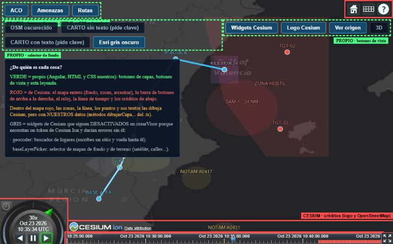

---

## 2. Quiero cambiar... → voy a...

La lógica está separada en **un fichero por cosa**, dentro de [`src/app/mapa-cesium/`](src/app/mapa-cesium). El componente (`mapa-cesium.component.ts`) solo se ocupa de los botones y de **llamar** a estas funciones.

| Quiero... | Voy a... |
|---|---|
| Cambiar la zona que se ve al arrancar, o qué widgets de Cesium salen | [`funciones/crear-mapa.function.ts`](src/app/mapa-cesium/funciones/crear-mapa.function.ts) |
| Cambiar o añadir un mapa de fondo | [`funciones/crear-capa-fondo.function.ts`](src/app/mapa-cesium/funciones/crear-capa-fondo.function.ts) |
| Mover, añadir o quitar zonas del espacio aéreo (ACM, NOTAM) | [`funciones/dibujar-capa-aco.function.ts`](src/app/mapa-cesium/funciones/dibujar-capa-aco.function.ts) |
| Mover, añadir o quitar zonas hostiles, el SAM o las dianas | [`funciones/dibujar-capa-amenazas.function.ts`](src/app/mapa-cesium/funciones/dibujar-capa-amenazas.function.ts) |
| Cambiar la ruta o sus puntos | [`funciones/dibujar-capa-rutas.function.ts`](src/app/mapa-cesium/funciones/dibujar-capa-rutas.function.ts) |
| Cambiar cómo se dibuja un óvalo / zona / punto (colores, transparencia, tamaño) | [`anadir-elipse`](src/app/mapa-cesium/funciones/anadir-elipse.function.ts), [`anadir-poligono`](src/app/mapa-cesium/funciones/anadir-poligono.function.ts), [`anadir-punto`](src/app/mapa-cesium/funciones/anadir-punto.function.ts) |
| Cambiar el aspecto de los textos del mapa | [`funciones/crear-etiqueta.function.ts`](src/app/mapa-cesium/funciones/crear-etiqueta.function.ts) |
| Cambiar el avión: icono, horas, recorrido, estela | [`funciones/dibujar-avion.function.ts`](src/app/mapa-cesium/funciones/dibujar-avion.function.ts) |
| Cambiar la velocidad del reloj, si arranca solo, la franja roja del timeline | [`funciones/configurar-reloj-mision.function.ts`](src/app/mapa-cesium/funciones/configurar-reloj-mision.function.ts) |
| Cambiar la hora de inicio o fin de la misión | [`models/inicio-mision.const.ts`](src/app/mapa-cesium/models/inicio-mision.const.ts) y [`models/fin-mision.const.ts`](src/app/mapa-cesium/models/fin-mision.const.ts) |
| Cambiar los botones (texto, orden, dónde van) | [`mapa-cesium.component.html`](src/app/mapa-cesium/mapa-cesium.component.html) |
| Cambiar el color o la posición de los botones | [`mapa-cesium.component.scss`](src/app/mapa-cesium/mapa-cesium.component.scss) |
| Cambiar qué hace un botón al pulsarlo | [`mapa-cesium.component.ts`](src/app/mapa-cesium/mapa-cesium.component.ts), métodos `onBoton...Pulsado` |
| Que se carguen los ficheros de Cesium / el puerto | [`angular.json`](angular.json) |

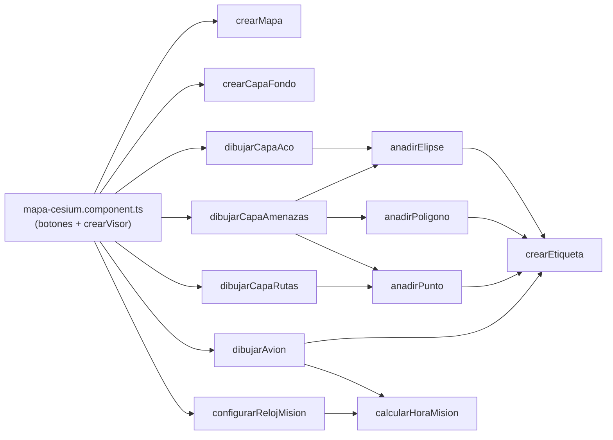

---

## 3. Paso a paso: construir el mapa

Este es el orden lógico. Cada paso se apoya en el anterior.

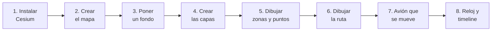

Todo se junta en el método `crearVisor` del componente, que sigue exactamente estos pasos:

```ts
private crearVisor(): void {
  // 1) El mapa en sí, con su fondo (funciones/crear-mapa y funciones/crear-capa-fondo)
  const visor = crearMapa(this.contenedorMapa().nativeElement, crearCapaFondo(this.fondoActivo()));
  this.visor = visor;

  // 2) Registramos las tres capas en el mapa
  visor.dataSources.add(this.capaAco);
  visor.dataSources.add(this.capaAmenazas);
  visor.dataSources.add(this.capaRutas);

  // 3) Dibujamos lo que va en cada capa (una función por capa)
  dibujarCapaAco(this.capaAco);
  dibujarCapaAmenazas(this.capaAmenazas);
  dibujarCapaRutas(this.capaRutas);
  dibujarAvion(this.capaRutas);

  // 4) El reloj y la línea de tiempo
  configurarRelojMision(visor);

  // 5) Cuando el recuadro ya tiene su tamaño definitivo, se coloca la vista inicial
  requestAnimationFrame(() => visor.camera.flyHome(0));
}
```

### Paso 1. Instalar Cesium y configurarlo

```bash
npm install cesium
```

Cesium necesita unos ficheros auxiliares (código que corre en segundo plano, imágenes, estilos) que no se mezclan con tu código. Hay que decirle a Angular que los **copie** al compilar. Se hace en [`angular.json`](angular.json), dentro de `build` → `options`:

```json
"assets": [
  { "glob": "**/*", "input": "public" },
  { "glob": "**/*", "input": "node_modules/cesium/Build/Cesium/Assets",     "output": "/cesium/Assets" },
  { "glob": "**/*", "input": "node_modules/cesium/Build/Cesium/ThirdParty", "output": "/cesium/ThirdParty" },
  { "glob": "**/*", "input": "node_modules/cesium/Build/Cesium/Widgets",    "output": "/cesium/Widgets" },
  { "glob": "**/*", "input": "node_modules/cesium/Build/Cesium/Workers",    "output": "/cesium/Workers" }
],
"styles": [
  "node_modules/cesium/Build/Cesium/Widgets/widgets.css",
  "src/styles.scss"
]
```

- `assets` copia las cuatro carpetas de Cesium a `/cesium/` en la web resultante. **No se copian a tu repositorio**: salen de `node_modules` cada vez que compilas, y se actualizan con `npm update cesium`.
- `styles` añade el CSS de los widgets de Cesium.

Y se le dice a Cesium dónde las ha de buscar (arriba de `crear-mapa.function.ts`):

```ts
(window as unknown as { CESIUM_BASE_URL: string }).CESIUM_BASE_URL = '/cesium';
```

### Paso 2. Crear el mapa (el *Viewer*)

📄 [`funciones/crear-mapa.function.ts`](src/app/mapa-cesium/funciones/crear-mapa.function.ts) · lo llama `crearVisor` (paso 1)

**Resultado:** el mapa de Cesium, todavía vacío (el azul oscuro es el color de Cesium cuando no hay mapa de fondo).

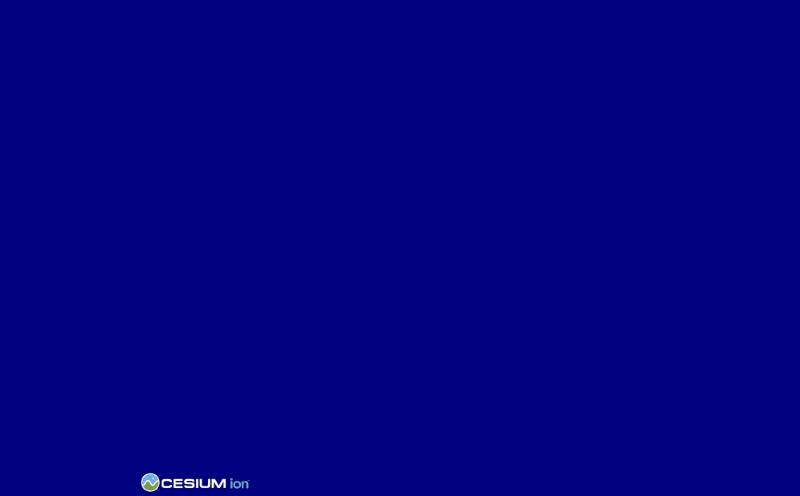

En el HTML del componente hay un hueco para el mapa:

```html
<div #contenedorMapa class="mapa-lienzo"></div>
```

En el `.ts`, una vez que el HTML ya existe, se crea el mapa dentro de ese hueco:

```ts
constructor() {
  afterNextRender(() => this.ngZone.runOutsideAngular(() => this.crearVisor()));
}
```

- `afterNextRender` espera a que el HTML exista antes de crear el mapa.
- `runOutsideAngular` evita que Angular se vuelva loco comprobando cambios en cada fotograma que Cesium dibuja.

La función `crearMapa` es la que crea el `Viewer`. Cada widget de Cesium es una opción `true` / `false`; todo lo que está a `false` desaparece:

```ts
return new Viewer(contenedor, {
  animation: true,        // reloj de abajo a la izquierda
  timeline: true,         // línea de tiempo de abajo
  homeButton: true,       // botón casa: vuelve a la vista inicial
  baseLayerPicker: false, // desactivado: necesita token de Cesium Ion
  geocoder: false,        // desactivado: necesita token de Cesium Ion
  baseLayer: capaFondo,
  sceneMode: SceneMode.SCENE2D,   // arranca plano (2D); también existe 3D
  ...
});
```

**Dónde empieza el mapa** (qué zona se ve al arrancar) se fija antes de crear el `Viewer`:

```ts
Camera.DEFAULT_VIEW_RECTANGLE = Rectangle.fromDegrees(-2.6, 37.3, 2.4, 40.9); // oeste, sur, este, norte
Camera.DEFAULT_VIEW_FACTOR = 0;
```

Esa misma zona es a la que vuelve el botón casa. Además, `crearVisor` vuelve a colocar la vista un fotograma después (`flyHome(0)`), porque si el recuadro todavía no tiene su tamaño final, la vista inicial no se ajusta bien.

### Paso 3. Poner un mapa de fondo

📄 [`funciones/crear-capa-fondo.function.ts`](src/app/mapa-cesium/funciones/crear-capa-fondo.function.ts)

El fondo son cuadraditos de imagen que Cesium pide a un servidor según la zona y el zoom. En la URL, `{z}` es el nivel de zoom y `{x}`, `{y}` la posición del cuadradito:

```ts
new ImageryLayer(new UrlTemplateImageryProvider({
  url: 'https://services.arcgisonline.com/ArcGIS/rest/services/Canvas/World_Dark_Gray_Base/MapServer/tile/{z}/{y}/{x}',
  credit: 'Esri, HERE, Garmin, OpenStreetMap contributors',
  maximumLevel: 18,
}))
```

**Resultado:** el mismo mapa, ya con su fondo.

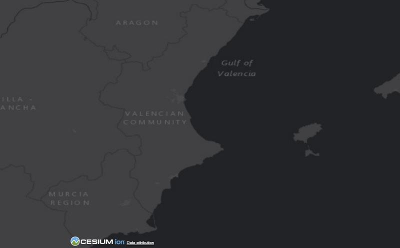

Fondos probados:

| Fondo | Resultado |
|---|---|
| **Esri gris oscuro** | ✅ El que mejor queda: tierra gris oscuro sobre mar casi negro. Es el que se usa por defecto |
| OpenStreetMap oscurecido | Funciona, pero es un mapa claro al que se le baja el brillo; queda ruidoso |
| CARTO (sin y con texto) | ❌ Ahora exigen una clave: sale una marca de agua "API KEY REQUIRED" |

| Esri gris oscuro | OpenStreetMap oscurecido | CARTO (pide clave) |
|---|---|---|
|  | 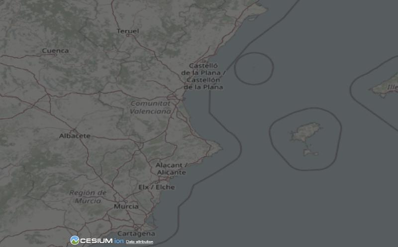 | 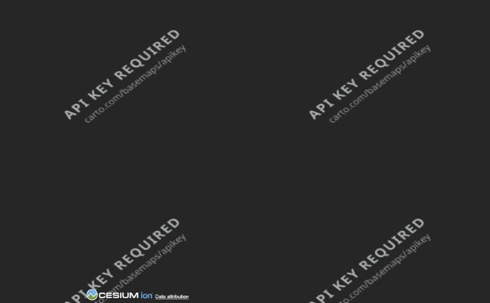 |

Notas:
- El texto de `credit` (autoría) es obligatorio por licencia; Cesium lo enseña abajo (ver [sección 7](#7-créditos-y-licencias)).
- Antes de un uso real hay que **mirar las condiciones de cada proveedor** y probablemente montar un servidor de mapas propio.
- Cambiar de fondo en caliente (`cambiarFondo`, en el componente) es quitar la capa vieja y poner la nueva, sin tocar nada de lo dibujado encima.

### Paso 4. Crear las capas

📄 [`mapa-cesium.component.ts`](src/app/mapa-cesium/mapa-cesium.component.ts) (propiedades de la clase y paso 2 de `crearVisor`)

Una capa es una "caja" (`CustomDataSource`) donde se meten entidades:

```ts
private readonly capaAco = new CustomDataSource('aco');
private readonly capaAmenazas = new CustomDataSource('amenazas');
private readonly capaRutas = new CustomDataSource('rutas');
```

Y se registran en el mapa:

```ts
visor.dataSources.add(this.capaAco);
```

Para **encender o apagar** una capa entera basta con `capa.show = true / false` (ver [sección 4](#4-los-botones-propios-y-los-de-prueba)).

**Resultado:** las tres capas existen y tienen su botón arriba a la izquierda, pero de momento están vacías, así que el mapa se ve igual que antes.

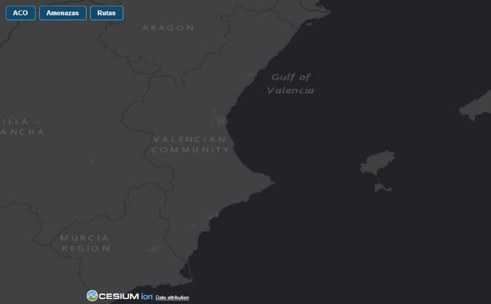

### Paso 5. Dibujar zonas, círculos y puntos

📄 [`dibujar-capa-aco`](src/app/mapa-cesium/funciones/dibujar-capa-aco.function.ts) · [`dibujar-capa-amenazas`](src/app/mapa-cesium/funciones/dibujar-capa-amenazas.function.ts) · y las tres herramientas: [`anadir-elipse`](src/app/mapa-cesium/funciones/anadir-elipse.function.ts), [`anadir-poligono`](src/app/mapa-cesium/funciones/anadir-poligono.function.ts), [`anadir-punto`](src/app/mapa-cesium/funciones/anadir-punto.function.ts)

Todo se dibuja con `capa.entities.add({...})`. Cada función `dibujarCapa...` es una lista de llamadas a las tres herramientas, con los datos escritos tal cual. Hay tres tipos de forma.

**Resultado de dibujar solo la capa ACO** (`dibujarCapaAco`, que usa `anadirElipse`): las esperas, la patrulla y los avisos NOTAM.

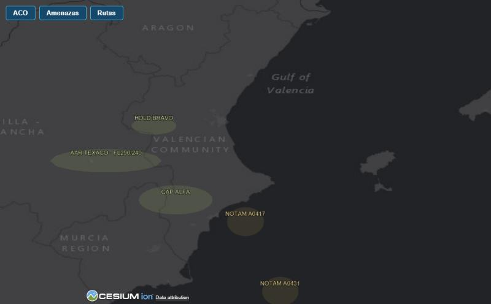

**Y al dibujar también la capa Amenazas** (`dibujarCapaAmenazas`, que añade polígonos, el círculo del SAM y las dianas):

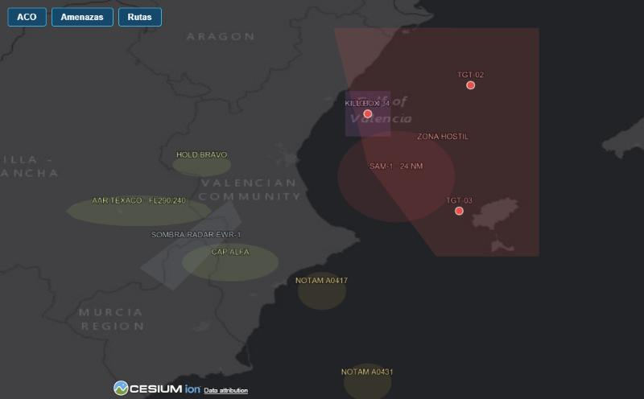

**Elipses** (esperas, CAP, NOTAM, el círculo del SAM) — `anadirElipse`:

```ts
// anadirElipse(capa, nombre, longitud, latitud, semieje mayor (NM), semieje menor (NM), giro (grados), color)
anadirElipse(capa, 'HOLD BRAVO', -1.15, 39.4, 12, 6, 0, '#b8d86b');
```

Dentro, Cesium pide los semiejes en **metros**, así que se convierte desde millas náuticas (1 NM = 1852 m). Un círculo es una elipse con los dos semiejes iguales:

```ts
anadirElipse(capa, 'SAM-1 · 24 NM', 0.55, 39.3, 24, 24, 0, '#e8504a');
```

**Polígonos** (zona hostil, kill box, sombra radar) — `anadirPoligono`: una pareja `[longitud, latitud]` por esquina.

```ts
anadirPoligono(capa, 'KILL BOX 34', '#c46ad8',
  [[0.1, 39.65], [0.5, 39.65], [0.5, 40.05], [0.1, 40.05]]);
```

**Puntos** (dianas, puntos de la ruta) — `anadirPunto`:

```ts
anadirPunto(capa, 'TGT-01', 0.3, 39.85, '#e8504a');
```

Cada entidad lleva también una **etiqueta** (el texto sobre la forma, función [`crearEtiqueta`](src/app/mapa-cesium/funciones/crear-etiqueta.function.ts)) y un color con transparencia (`color.withAlpha(0.12)`) para que se vea el mapa debajo.

### Paso 6. Dibujar la ruta

📄 [`funciones/dibujar-capa-rutas.function.ts`](src/app/mapa-cesium/funciones/dibujar-capa-rutas.function.ts)

La ruta es una línea (`polyline`) que une las coordenadas en orden:

```ts
capa.entities.add({
  name: 'Ruta B',
  polyline: {
    material: Color.fromCssColorString('#3fb8e8'),
    positions: Cartesian3.fromDegreesArray([
      -1.5, 38.0,   // BASE ALFA
      -1.2, 38.45,  // WP1
      ...
    ]),
    width: 4,
  },
});
```

Aquí las coordenadas van **todas seguidas en una lista plana**: longitud, latitud, longitud, latitud... Después se ponen los puntos con su nombre encima (`anadirPunto`).


### Paso 7. El avión que se mueve

📄 [`funciones/dibujar-avion.function.ts`](src/app/mapa-cesium/funciones/dibujar-avion.function.ts) · horas en [`calcular-hora-mision`](src/app/mapa-cesium/funciones/calcular-hora-mision.function.ts)

Un avión no "se mueve": se le dice **dónde está en cada hora** y Cesium calcula lo que hay en medio. Está en tres partes.

**7.1. Dónde está y cuándo** (`SampledPositionProperty`): una lista de pares (hora, posición).

```ts
const posicion = new SampledPositionProperty();
posicion.addSample(calcularHoraMision(0),  Cartesian3.fromDegrees(-1.5, 38.0));  // 10:25 BASE ALFA
posicion.addSample(calcularHoraMision(7),  Cartesian3.fromDegrees(-1.0, 38.9));  // 10:32 VALLE
posicion.addSample(calcularHoraMision(20), Cartesian3.fromDegrees(0.3, 39.85));  // 10:45 TGT-01
```

La hora se da en minutos desde el inicio de la misión (`INICIO_MISION`, las 10:25 UTC). Entre dos muestras, Cesium traza una línea recta.

**7.2. Hacia dónde mira.** Un icono no sabe girar solo. Se usa una función (`CallbackProperty`) que Cesium ejecuta en cada fotograma: compara dónde estaba el avión 5 segundos antes y dónde estará 5 después, calcula el rumbo y gira el icono.

```ts
const giroIcono = new CallbackProperty(tiempo => {
  ...
  const rumbo = Math.atan2(haciaElEste, haciaElNorte); // 0 = norte, sentido horario
  ultimoRumbo = Math.PI / 4 - rumbo; // el dibujo apunta 45° al noreste; Cesium gira al revés
  return ultimoRumbo;
}, false);
```

**7.3. El avión como entidad**: icono (`billboard`), estela (`path`) y texto.

```ts
capa.entities.add({
  name: 'Avión',
  availability: new TimeIntervalCollection([new TimeInterval({ start: INICIO_MISION, stop: FIN_MISION })]),
  position: posicion,
  billboard: { image: '/avion.svg', width: 32, height: 32, rotation: giroIcono,
               alignedAxis: Cartesian3.UNIT_Z },
  path: { leadTime: 0, trailTime: 600, width: 2, ... },  // estela de los últimos 10 min
  label: crearEtiqueta('AVIÓN', Color.WHITE),
});
```

- `image: '/avion.svg'` es el fichero [`public/avion.svg`](public/avion.svg).
- `availability` hace que el avión **solo exista** entre el inicio y el fin de la misión. Esto mismo servirá para que las zonas aparezcan y desaparezcan según su horario.
- `alignedAxis: UNIT_Z` hace que el "arriba" del icono sea siempre el norte, también en 3D.

**Resultado:** el avión recorre la ruta solo, girando hacia donde va (aquí, a mitad de camino).

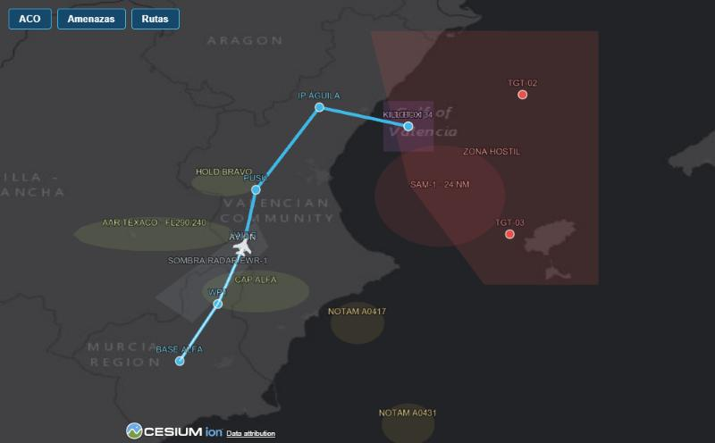

### Paso 8. El reloj y la línea de tiempo

📄 [`funciones/configurar-reloj-mision.function.ts`](src/app/mapa-cesium/funciones/configurar-reloj-mision.function.ts)

El **reloj** (`visor.clock`) es el que manda la hora. La **línea de tiempo** es solo la barra que lo enseña y permite moverlo:

```ts
visor.clock.startTime = INICIO_MISION.clone();   // 10:25
visor.clock.stopTime = FIN_MISION.clone();       // 10:45
visor.clock.currentTime = INICIO_MISION.clone();
visor.clock.clockRange = ClockRange.LOOP_STOP;   // al llegar al final vuelve al principio
visor.clock.multiplier = 30;                     // 30 s simulados por cada segundo real
visor.clock.shouldAnimate = true;                // arranca ya en marcha
visor.timeline?.zoomTo(INICIO_MISION, FIN_MISION);
```

| Quiero... | Lo cambio así |
|---|---|
| Que no arranque solo | `shouldAnimate = false` |
| Ir más rápido o más lento | `multiplier` (1 = tiempo real) |
| Que se pare al final | `ClockRange.CLAMPED` en vez de `LOOP_STOP` |
| Saltar a una hora | `clock.currentTime = una hora` |

**Resultado:** abajo a la izquierda el reloj (con la velocidad `30x` y la hora) y abajo la línea de tiempo con el marcador de la hora actual.

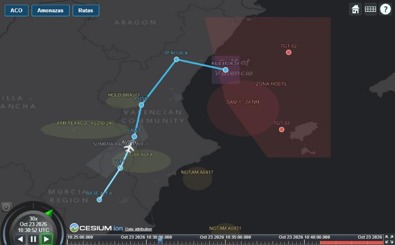

También hay una franja roja en la barra (el tramo dentro de la zona hostil). Cesium tiene el método para pintarla (`addHighlightRange`) pero **no lo declara en sus tipos de TypeScript**, así que está descrito a mano en [`models/linea-tiempo-con-franjas.interface.ts`](src/app/mapa-cesium/models/linea-tiempo-con-franjas.interface.ts).

> 💡 **El timeline de Cesium se puede sustituir.** Como el que manda es el reloj, se puede quitar el widget (`timeline: false`, `animation: false`) y hacer un componente propio con botones de play, velocidad y una barra, que simplemente lea y escriba en `visor.clock`. Está pendiente de hacer.

---

## 4. Los botones propios y los de prueba

Los botones ACO, Amenazas y Rutas no son de Cesium: son HTML normal de Angular. Se escriben uno a uno en [`mapa-cesium.component.html`](src/app/mapa-cesium/mapa-cesium.component.html):

```html
<nav class="mapa-capas">
  <button
    type="button"
    [class.activo]="acoVisible()"
    (click)="onBotonAcoPulsado()">ACO</button>
  ...
</nav>
```

- `[class.activo]` añade la clase `activo` (botón encendido) cuando `acoVisible()` es verdadero.
- `(click)` llama al método del `.ts`.

Y el método solo enciende o apaga la capa de Cesium:

```ts
onBotonAcoPulsado(): void {
  this.acoVisible.update(visible => !visible);
  this.capaAco.show = this.acoVisible();
}
```

El aspecto está en [`mapa-cesium.component.scss`](src/app/mapa-cesium/mapa-cesium.component.scss): el estilo común en `nav button`, el botón encendido en `&.activo` y la posición de cada grupo en `nav.mapa-capas`, `nav.mapa-fondos` y `nav.mapa-vista`.

**Poner un botón en otro sitio** (por ejemplo, un icono arriba a la derecha) es: añadir el `<button>` dentro del `<nav>` que quieras, o crear otro `<nav>` y darle posición con `position: absolute` y `top` / `right` en el SCSS.

### Botones de prueba (arriba a la derecha)

| Botón | Qué hace |
|---|---|
| **Widgets Cesium** | Muestra u oculta los widgets de Cesium (barra de iconos, reloj, timeline, pantalla completa, ventana de información). Los créditos se quedan siempre |
| **Logo Cesium** | Muestra u oculta solo el logo "CESIUM ion". El enlace "Data attribution" se queda |
| **Ver origen** | Colorea qué es propio (verde) y qué es de Cesium (rojo), con una leyenda |
| **2D / 3D** | Cambia entre mapa plano y globo: `visor.scene.morphTo3D(1)` / `morphTo2D(1)` |

Los widgets y el logo se esconden **solo con CSS** (no se destruyen). Un detalle: Cesium escribe `display: inline` directamente en el logo, así que la regla de CSS necesita `!important` para ganarle.

| Widgets activados | Widgets desactivados |
|---|---|
|  | 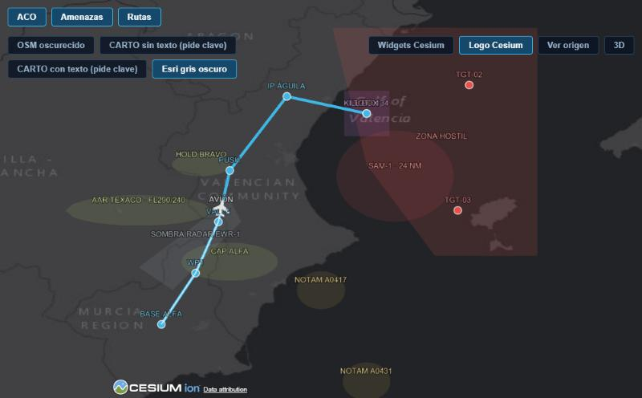 |

---

## 5. Meter el mapa dentro de una web

El mapa **no ocupa la pantalla entera por sí mismo**: ocupa el tamaño de su contenedor, y Cesium se reajusta solo si el contenedor cambia. La condición es que el contenedor **tenga una altura definida**; si no, el mapa mide 0 y no se ve.

[`pagina-demo/`](src/app/pagina-demo) es una maqueta con recuadros negros para ver cómo queda:

```
┌───────────────────────────────────────────┐
│  CABECERA                                 │
├────────────┬──────────────────────────────┤
│            │  TÍTULO Y FILTROS            │
│   MENÚ     ├──────────────────────────────┤
│  LATERAL   │                              │
│            │         EL MAPA              │
│            │   (componente app-mapa-cesium)
│            │                              │
└────────────┴──────────────────────────────┘
```

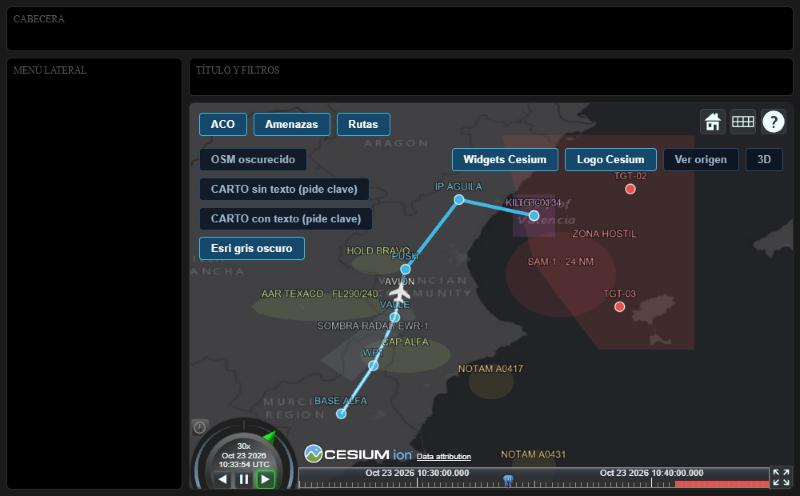

El HTML solo pone el componente en su recuadro:

```html
<section class="pagina-mapa">
  <app-mapa-cesium/>
</section>
```

Y el SCSS usa una cuadrícula (`display: grid`) para repartir el espacio. Dos líneas son clave para que el mapa respete su recuadro:

```scss
main.pagina-contenido { min-height: 0; ... }  // sin esto el mapa empuja la página y se sale de la pantalla
section.pagina-mapa   { min-height: 0; overflow: hidden; }
```

En pantallas estrechas (menos de 800 px) el menú lateral se esconde y los botones de fondo bajan a su propia fila.

**Qué escala y qué no** al cambiar el tamaño: las zonas, la ruta y las dianas están en coordenadas reales, así que escalan solas con el zoom; los puntos, el avión y los textos miden píxeles y mantienen su tamaño.

---

## 6. Trucos y errores típicos

- **Longitud primero, latitud después.** Si algo aparece en medio del océano o en África, es esto.
- **El mapa sale vacío o con altura 0**: el contenedor no tiene altura (ver sección 5).
- **Aparece el mundo entero en lugar de la zona**: la vista inicial se fija con `Camera.DEFAULT_VIEW_RECTANGLE` antes de crear el `Viewer`, y se recoloca un fotograma después con `flyHome(0)`. Si se hace con `setView` en el momento de crear, no se adapta bien a un recuadro pequeño.
- **Los semiejes de las elipses van en metros**, no en millas ni grados.
- **`baseLayerPicker` y `geocoder` piden un token de Cesium Ion** (una cuenta gratuita de Cesium). Por eso están desactivados.
- **Si cambias `angular.json`** hay que parar y volver a arrancar `npm start`.
- **Si `npm start` dice que el puerto está en uso**, hay otro servidor corriendo (a veces de otra carpeta). Se puede ver con `netstat -ano | findstr :4300`.
- **Al hacer una captura de pantalla** del mapa justo tras cargar puede verse medio vacío: los cuadraditos del fondo tardan unos segundos en llegar.
- El mapa de fondo gratuito de OpenStreetMap **no se debe usar en producción** (sus normas lo restringen).

---

## 7. Créditos y licencias

> Esto es una **orientación**, no asesoramiento legal. Revisado en la web de Cesium el 25-10-2026; las condiciones pueden cambiar, y antes de un uso real las debe revisar quien gestione las licencias.

### Resumen rápido

- Los **créditos de los mapas** (Esri, OpenStreetMap...) los exige quien pone los datos. Se muestran mientras se usen mapas de terceros.
- El **logo de Cesium** solo se exige de forma explícita cuando se usa **Cesium ion** (su servicio en la nube). En una aplicación sin Cesium ion no parece obligatorio por lo que dicen sus textos, pero no lo confirman, y su guía tampoco dice que se pueda quitar.
- La licencia de la librería (Apache 2.0) no obliga a mostrar ningún logo.
- ⚠️ **Todo esto hay que revisarlo legalmente a fondo antes de un uso real.** Lo de aquí es lo que dicen las páginas de Cesium a fecha de hoy.

### Qué créditos salen en el mapa y de quién son

Abajo a la izquierda del mapa salen dos cosas distintas:

| Qué se ve | De quién es | Cómo se controla |
|---|---|---|
| **Logo "CESIUM ion"** | De Cesium. Lo pone la librería por defecto | Botón **Logo Cesium** (solo lo esconde con CSS) |
| **Enlace "Data attribution"** | Lo genera Cesium, pero su contenido son los créditos **de los mapas y datos de terceros** (Esri, OpenStreetMap...) | El texto sale del campo `credit` que se pasa al crear cada mapa de fondo (`crearCapaDesdeUrl`, en `crear-capa-fondo.function.ts`) |

Los créditos de los **mapas** los exige quien pone los datos: mientras se use Esri u OpenStreetMap hay que mostrarlos. Con un servidor de mapas propio hecho con datos totalmente propios no habría terceros a quienes acreditar; pero si ese servidor se construye a partir de datos abiertos (por ejemplo OpenStreetMap), la atribución a esa fuente sigue siendo obligatoria.

### Qué dice Cesium sobre su logo

Según su [guía de uso y atribución](https://cesium.com/learn/ion/content-usage-and-attribution-guide/):

- *"You must prominently display the Cesium ion logo in software or content you create with Cesium ion."* Es decir, la obligación está escrita para el software o contenido que se crea **con Cesium ion** (su servicio en la nube: terreno, mapas, 3D Tiles y geocodificador, que usan un token).
- Se puede **cambiar la colocación y la presentación** del logo, pero tiene que seguir siendo "prominente": que sea más probable que lo vea el usuario a que no.
- La guía **no dice que se pueda quitar** y tampoco aclara el caso de una aplicación que **no usa nada de Cesium ion**, que es el nuestro: los datos son de Esri y de nuestro escenario, sin token.
- Los [términos de servicio de Cesium ion](https://cesium.com/legal/terms-of-service/) añaden que no se puede quitar "un aviso de copyright, descargo de responsabilidad u otra forma de atribución" de los servicios licenciados. Están escritos para los servicios de Cesium ion, no para la librería sola.
- La licencia de la propia librería, [Apache 2.0](https://github.com/CesiumGS/cesium/blob/main/LICENSE.md), **no menciona ningún logo ni obliga a mostrarlo**. Pide conservar los avisos de copyright en el código y no concede permiso para usar sus marcas.

### Qué significa para este proyecto

- **Hoy** (sin Cesium ion, con mapas de Esri): lo que está claro es que los créditos de los mapas se deben mostrar. Sobre el logo de Cesium, por lo que dicen los textos no parece obligatorio al no usar su servicio, pero **no lo afirman de forma explícita**.
- **Si algún día se usa Cesium ion** (token, terreno, mapas o geocodificador suyos), el logo hay que mostrarlo.
- El botón **Logo Cesium** de la demo es solo para ver cómo funciona; antes de un uso real, lo prudente es preguntar a Cesium directamente (por ejemplo por su foro o su contacto comercial) y dejar la respuesta por escrito.
